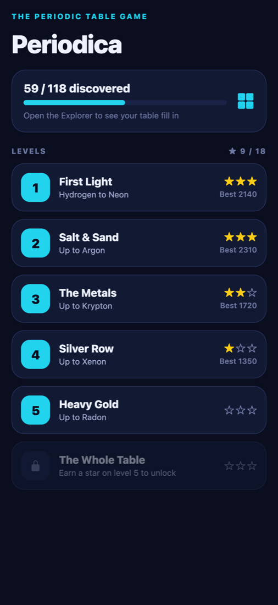
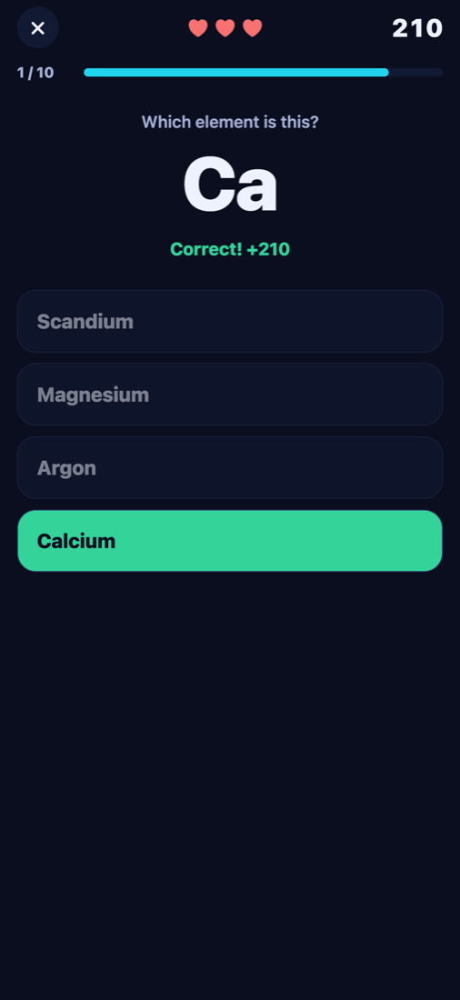
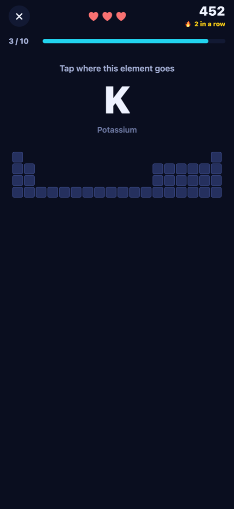
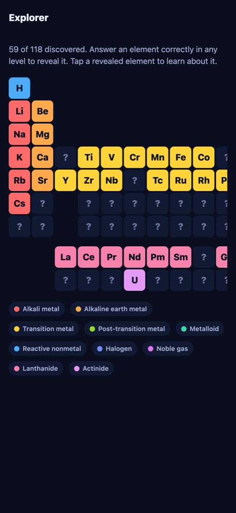

<p align="center">
  
</p>

<h1 align="center">Periodica</h1>

<p align="center">
  <strong>The periodic table, as a game.</strong><br />
  Quick rounds, a blank table to fill from memory, and all 118 elements to discover.
</p>

<p align="center">
  
  
  
  
  
</p>

<p align="center">
  
  
  
  
</p>

---

## How it plays

- **Rounds of 10 questions** with a 12-second timer and 3 lives. Five kinds of question rotate: name the symbol, give the symbol, name the atomic number, pick the family, and **Place it**: tap where an element belongs on a blank periodic table.
- **Score** = 100 + a speed bonus, multiplied by your streak (up to ×2).
- **Stars**: a perfect round earns 3, one slip 2, two slips 1. Run out of lives and you get none.
- **Six levels** open the table row by row: Hydrogen to Neon, then Argon, Krypton, Xenon, Radon, and finally all 118. Each needs a star on the one before.
- **Collection**: every element you answer correctly is discovered. The **Explorer** shows your table filling in, coloured by family; tap any discovered element for its card.
- Options are chosen to be tricky (same family or a neighbour), and no element appears twice in a round.

## Accurate by test

All the element data lives in [`src/game/elements.ts`](src/game/elements.ts): symbols, names, families and room-temperature states, with period, group and grid position calculated from the atomic number. The tests check it: 118 unique elements, every period and group (alkali metals in 1, halogens in 17, noble gases in 18, hafnium in 4 after the lanthanides), the f-block rows, no two elements in one cell, and exactly the 11 gases and 2 liquids at room temperature.

## Tech

- **Expo SDK 58** (React Native 0.88, React 19.3), Expo Router, TypeScript (strict), React Compiler
- Pure game logic in `src/game/levels.ts` (seeded rounds, scoring, stars, unlocks); AsyncStorage for progress
- **Jest** + React Native Testing Library

```
src/
  app/        index (levels), onboarding, play/[level], explorer, element/[z]
  game/       elements.ts (data), levels.ts (rules), table.tsx (the grid), look.ts
  data/       progress.ts (stars, best scores, discovered elements)
__tests__/    data accuracy, rules and scoring, and real play-throughs
```

## Getting started

```bash
npm install
npx expo start          # press i for iOS, a for Android, w for web
npm test                # 19 tests
```

The play-through tests read each question off the screen and answer it like a player: a perfect round earns 3 stars, discovers 10 elements and unlocks level 2; three wrong answers end the round.

## Roadmap

- [ ] Daily challenge and streaks
- [ ] Sounds and a short celebration on level-up
- [ ] Atomic mass and electron configuration on element cards
- [ ] Classroom mode: a teacher sets the elements to practise

## Author

Built by **Olateju Olamide Emmanuel**, mobile developer & ML engineer.
[Portfolio](https://tejusportfolio.vercel.app) · [GitHub](https://github.com/tejHacks) · [LinkedIn](https://www.linkedin.com/in/olateju-olamide-22314a292/)

## License

MIT, see [LICENSE](LICENSE).
